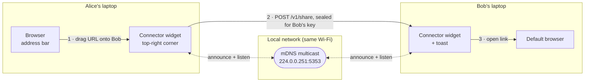
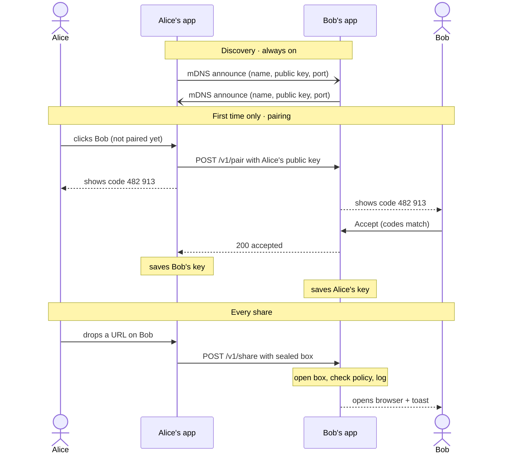

# Connector architecture

> **Status:** draft. Nothing is built yet.

Every laptop runs the same Python app. There is no server. Apps find each other with mDNS and send links straight over the local Wi-Fi, encrypted so only the chosen laptop can open them.

## Decisions on the original picks

| | Decision | Reason |
|---|---|---|
| **Python** | Keep | Nothing here is CPU-heavy, and every piece has a solid library. The real cost is installer size: roughly 50–100 MB with Qt bundled. |
| **SQLite** | Keep | Right size for settings, paired peers and link history. Use the built-in `sqlite3` module with a version number for migrations. Three tables don't need an ORM. |
| **OS keychain** | Add | Store the device's private key in macOS Keychain or Windows Credential Manager through `keyring`, so copying the database file doesn't copy the identity. |
| **TLS certificates** | Skip | Each laptop gets a Curve25519 key pair. PyNaCl's `Box` encrypts a link for one receiver and proves who sent it, so plain HTTP on the LAN is enough. |

## Stack

| Layer | Pick | Why |
|---|---|---|
| Language | Python 3.12 + uv | uv manages the virtualenv, dependencies and lockfile. |
| Desktop UI | PySide6 (Qt 6) | Frameless, always-on-top tool window for the corner widget. Accepts URLs dragged out of a browser (`QMimeData.urls()`). Tray icon built in. Tkinter can't take browser drops without add-ons. |
| Event loop | qasync | Runs asyncio on Qt's event loop, so the UI and the networking share one thread and need no locks. |
| Discovery | zeroconf | Pure-Python mDNS / DNS-SD. Registers `_connector._tcp.local.` and browses for the others. No Bonjour install needed on Windows. |
| Transport | aiohttp | A two-route server and a client, both asyncio. FastAPI with uvicorn is more than two endpoints need and is awkward to run inside the Qt loop. |
| Crypto | PyNaCl | libsodium bindings. `Box` gives encryption and sender authentication in one call. A 6-digit code derived from both public keys makes pairing checkable by eye. |
| Secrets | keyring | Keeps the private key in the OS keychain. |
| Database | SQLite (`sqlite3`) | Settings, paired peers, link history. `PRAGMA user_version` tracks the schema version. |
| Opening links | `webbrowser` (stdlib) | Opens the system default browser on Windows and macOS, after the http/https check. |
| File paths | platformdirs | Puts the database in the right per-user folder on each OS. |
| Packaging | PyInstaller | One build per OS, since it can't cross-compile, so run it on a GitHub Actions matrix. macOS builds need signing, notarization and an `NSLocalNetworkUsageDescription` string for the Local Network prompt. |
| Tests | pytest + pytest-asyncio | Two instances with separate data folders on one machine discover each other, which covers most integration tests. |
| *Later* | bleak + bless | Bluetooth LE fallback for Wi-Fi that blocks device-to-device traffic. A URL is small enough to fit. |
| *Later* | Browser extension | "Send this tab to…" menu that talks to the app through native messaging. |

## How a link travels



1. Alice drags a link from the address bar onto Bob in the corner widget.
2. Alice's app encrypts it for Bob's key and posts it straight to Bob's app over the local network.
3. Bob's app checks that Alice is paired and the link is http(s), opens it in the default browser and shows a toast.

The dotted mDNS path runs all the time. It is how each widget knows who is online.

## Inside the app

One process per laptop. Every laptop is both a sender and a receiver, so the same modules appear on more than one path.

```mermaid
flowchart TB
  subgraph Discovery["Discovery · always on"]
    direction LR
    L1(["Other laptops"]) <-.->|mDNS| Disc["Discovery<br/>zeroconf"]
    Disc -.->|"peer up / down"| Reg["Peer registry<br/>in memory"]
    Reg -.->|"who's online"| W1["Peer widget"]
  end

  subgraph Send["Sending"]
    direction LR
    Br["Browser<br/>address bar"] -->|"drop URL"| W2["Peer widget"]
    W2 -->|"send(peer, url)"| Sh["Share service"]
    Sh -->|seal| C1["Crypto<br/>PyNaCl Box"]
    C1 --> HC["HTTP client<br/>aiohttp"]
    HC -->|"POST /v1/share"| L2(["Other laptops"])
  end

  subgraph Receive["Receiving"]
    direction LR
    L3(["Other laptops"]) -->|"POST /v1/share"| HS["HTTP server<br/>aiohttp"]
    HS -->|open| C2["Crypto<br/>PyNaCl Box"]
    C2 -->|verified| Pol["Policy check<br/>paired? http(s)?"]
    Pol -->|allowed| Op["Opener<br/>webbrowser"]
    Op --> DB["Default browser"]
  end
```



- **UI (PySide6):** peer widget (list, drop target, toasts), pairing dialog, tray and settings.
- **Core:** peer registry, share service, pairing service, policy check.
- **Network:** discovery (zeroconf), HTTP client and server (aiohttp).
- **Storage:** the policy check logs every link to SQLite and reads paired peers from it. Crypto loads the private key from the OS keychain.

Who is online lives only in memory. SQLite holds what must survive a restart.

## Pairing, then sharing

Without pairing, anyone on the same Wi-Fi could make links open on your laptop. Pairing happens once per pair of people. Both screens show a 6-digit code computed from the two public keys. If the codes match, no one is sitting in the middle, and Bob clicks Accept. After that, each app keeps the other's key in SQLite and only accepts messages that open with it.



The pairing code is the first six digits of SHA-256 over both public keys, sorted, so both apps compute the same number without sending it. `/v1/pair` holds the request open for up to 60 seconds while Bob decides.

## Wire format

Each app listens on a random free port on all network interfaces. The port travels in the mDNS record, so nothing needs configuring.

### mDNS record

```text
service   Bob-MacBook._connector._tcp.local.
port      53421                # random free port, from the SRV record
TXT       v=1
          id=3f9c2a71e0b4d8a6  # first 8 bytes of SHA-256(public key), hex
          name=Bob
          pk=Hk2x…Q8=          # Curve25519 public key, base64 (44 chars)
```

### Endpoints

| Route | Body | Responses |
|---|---|---|
| `POST /v1/pair` | `{"pk", "name"}` | 200 accepted · 403 declined · 408 no answer within 60 s |
| `POST /v1/share` | `{"from", "box"}` | 202 delivered · 400 bad link · 403 not paired · 409 replay · 429 too many |

### Share message

Request body:

```json
{
  "from": "<Alice's public key, base64>",
  "box":  "<base64 of Box(alice_sk, bob_pk).encrypt(payload)>"
}
```

Payload inside the box, readable only by Bob:

```jsonc
{
  "type":    "link",
  "url":     "https://github.com/acme/app/pull/42",
  "title":   "Fix login redirect · acme/app",   // optional
  "msg_id":  "b41e0c7e-2c55-4f7e-9f0e-5a8d1f3c2e10",
  "sent_at": "2026-09-29T14:03:11Z"
}
```

If `Box(bob_sk, alice_pk).decrypt()` succeeds, the message came from the laptop holding Alice's private key and nobody changed it on the way. The `type` field leaves room for files, text snippets and troll payloads later.

## Database

Who is online right now lives in memory and is rebuilt from mDNS on every start. SQLite only holds what must survive a restart.

```sql
-- PRAGMA user_version = 1
CREATE TABLE settings (
  key    TEXT PRIMARY KEY,           -- display_name, avatar_color, auto_open, do_not_disturb
  value  TEXT NOT NULL
);

CREATE TABLE peers (
  public_key  TEXT PRIMARY KEY,      -- base64, 32 bytes
  name        TEXT NOT NULL,
  trust       TEXT NOT NULL DEFAULT 'paired',   -- 'paired' | 'blocked', later 'friend'
  auto_open   INTEGER NOT NULL DEFAULT 1,       -- 0 = show a toast, wait for a click
  paired_at   TEXT NOT NULL,
  last_seen   TEXT
);

CREATE TABLE shares (
  msg_id      TEXT PRIMARY KEY,      -- also how replays are caught
  direction   TEXT NOT NULL CHECK (direction IN ('in', 'out')),
  peer_key    TEXT NOT NULL REFERENCES peers(public_key),
  url         TEXT NOT NULL,
  title       TEXT,
  status      TEXT NOT NULL,         -- 'opened' | 'held' | 'rejected' | 'failed'
  created_at  TEXT NOT NULL
);
CREATE INDEX shares_by_time ON shares(created_at DESC);
```

## Rules the receiver enforces

- Only paired peers can deliver a link. Anyone else gets 403 and, at most, a pairing request you can ignore.
- Only `http://` and `https://` links up to 2,048 characters. Everything else is rejected, including `file:`, `javascript:` and custom schemes like `ms-msdt:`, which attackers have used to launch programs through Windows protocol handlers.
- A message sent more than 60 seconds ago, or with a `msg_id` already in `shares`, is dropped as a replay.
- At most 10 links a minute from one peer, so nobody can bury your screen.
- Do Not Disturb holds incoming links in the inbox instead of opening them.
- Troll mode comes later as a separate `friend` trust level that both people turn on.

## Project layout

```text
connector/
  pyproject.toml
  src/connector/
    __main__.py        # start Qt + qasync, load identity, wire services
    ui/widget.py       # always-on-top peer list, drop target, toasts
    ui/pairing.py      # code confirmation dialog
    ui/tray.py         # tray icon, settings, Do Not Disturb
    core/registry.py   # online peers merged with paired peers
    core/share.py      # send and receive links
    core/pairing.py
    core/policy.py     # scheme check, replay, rate limit
    net/discovery.py   # zeroconf register + browse
    net/server.py      # aiohttp routes /v1/pair, /v1/share
    net/client.py
    crypto.py          # key pair, seal/open, pairing code
    store.py           # sqlite3 + migrations
    opener.py
  tests/
```

## Build order

1. **Discovery spike.** Two terminal instances print each other's names via zeroconf.
2. **The widget.** A frameless, always-on-top window that lists peers and accepts a dropped URL.
3. **Plain sharing.** POST the URL to the peer and open it with `webbrowser`. This is the first end-to-end demo on two laptops.
4. **Identity and pairing.** Key pairs, keyring, the pairing code, sealed boxes and the `peers` table.
5. **Receiver rules and polish.** Scheme check, replay and rate limits, toasts, inbox and tray settings.
6. **Ship.** PyInstaller builds for Windows and macOS, signing, then a test on a real office Wi-Fi.

## After v1

- A browser extension for "send this tab".
- A Bluetooth LE fallback for networks that block device-to-device traffic.
- Friend-only troll mode.
