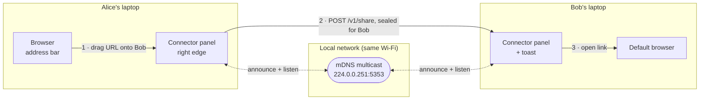
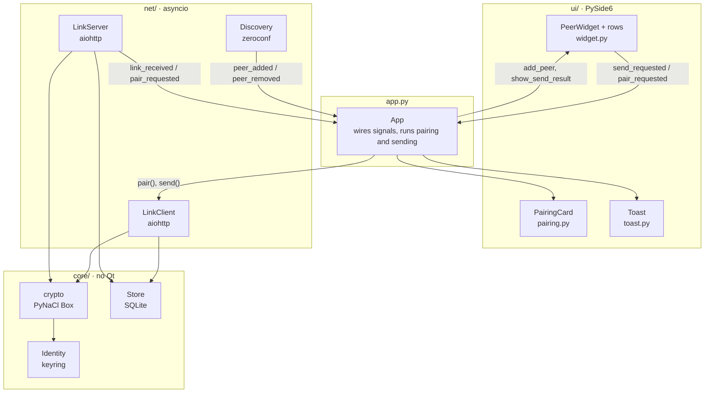
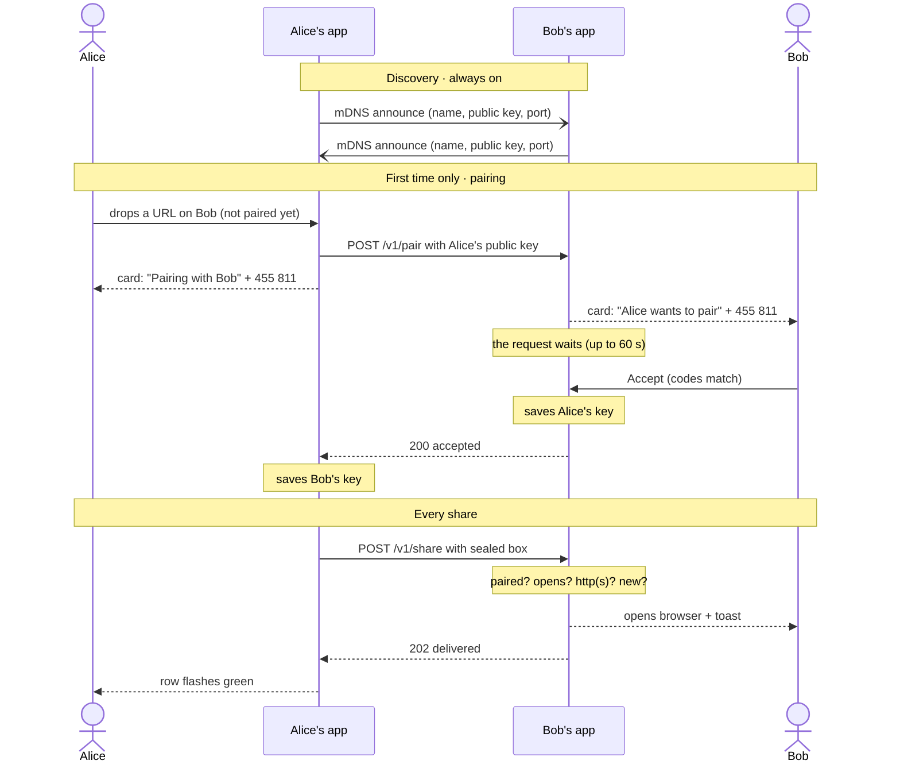

# Connector architecture

> **Status:** steps 1–4 of the [build order](#build-order) are built. Laptops find each other, pair once with a 6-digit code, and send each other sealed links. Step 5 (receiver rules and polish) is next.

Every laptop runs the same Python app. There is no server and no internet involved. Apps find each other with mDNS on the local network and send links straight to each other over HTTP, sealed so only the chosen laptop can read them and it knows for certain who sent them.

## Key decisions

| Decision | Why |
|---|---|
| **Python + PySide6 (Qt)** | Nothing here is CPU-heavy, and every piece has a solid library. The cost is installer size, roughly 50–100 MB with Qt. |
| **One thread, via qasync** | Qt's event loop and asyncio's would each block the thread. qasync runs asyncio *on* Qt's loop, so UI events and network code take turns on one thread: no locks, and widgets can be updated directly from network code. Rule: never block in a coroutine. |
| **No TLS: sealed boxes instead** | Each laptop has a Curve25519 key pair. PyNaCl's `Box` encrypts a message for one receiver and proves who sent it in one call, so plain HTTP on the LAN is enough and there are no certificates to manage. |
| **Pairing by comparing a code** | Keys arrive over mDNS, which anyone on the network could fake. Both screens show a code derived from both keys; if someone swapped in their key, the codes differ. After that the keys are trusted for good. |
| **Private key in the OS keychain** | Stored with `keyring` (Windows Credential Manager), not next to the database, so copying the app's files doesn't copy its identity. |
| **SQLite via `sqlite3`** | Two small tables. No ORM; migrations are numbered scripts tracked with `PRAGMA user_version`. |
| **aiohttp, not FastAPI** | A two-route server plus a client in one asyncio library, started inside the Qt loop on a random port. |
| **Live glass by screen capture** | Windows' own blur is fixed and heavy. The widget captures the screen behind itself, blurs and refracts it, and paints that. Trade-off: to capture what's behind it, the widget is excluded from all screen captures, so it doesn't appear in screenshots, recordings or screen sharing. |
| **Profiles** | `--profile` gives a copy its own key and database, so two copies on one laptop behave like two laptops. |

## Stack

| Layer | Pick | Notes |
|---|---|---|
| Language | Python 3.12 + uv | uv manages the virtualenv, dependencies and lockfile. |
| UI | PySide6 (`pyside6-essentials`) | Frameless, always-on-top tool windows. Drag and drop through `QMimeData`. |
| Event loop | qasync | `qasync.run()` is `asyncio.run()` with Qt's loop underneath. |
| Discovery | zeroconf | mDNS / DNS-SD: registers `_connector._tcp.local.` and browses for others. |
| Transport | aiohttp | `LinkServer` (two routes) and `LinkClient`. |
| Crypto | PyNaCl | `Box` (X25519 + XSalsa20-Poly1305) for sealing; SHA-256 for the pairing code. |
| Secrets | keyring | Service `Connector`, account `device-key/<profile>`. |
| Database | SQLite (`sqlite3`) | One file per profile. |
| Paths | platformdirs | `%LOCALAPPDATA%\Connector\profiles\<profile>\` on Windows. |
| Opening links | `QDesktopServices.openUrl` | Opens the default browser, after a final http(s) check. |
| Glass effects | numpy | Per-pixel edge refraction (`ui/optics.py`). |
| Windows APIs | ctypes | Capture exclusion and DWM settings (`ui/glass.py`). |
| *Planned* | pytest + pytest-asyncio | So far, checks are run as throwaway scripts. |
| *Planned* | PyInstaller | One build per OS on a GitHub Actions matrix; macOS needs signing, notarization and `NSLocalNetworkUsageDescription`. |

## How a link travels



1. Alice drags a link from the address bar onto Bob's row in her panel.
2. Alice's app seals it for Bob's public key and posts it to Bob's app at the address and port from his mDNS record.
3. Bob's app checks that Alice is paired, the message opens with her key, the link is http(s) and the message is new. It opens the link in the default browser and shows "Alice sent you a link".

The dotted mDNS path runs all the time. It's how each panel knows who is online.

## Inside the app



- **Parts talk through Qt signals.** Discovery, the server and the panel don't know about each other; they announce what happened (`peer_added`, `link_received`, `send_requested`…) and `App` connects them.
- **`core/` has no Qt in it**, so the security rules (`links.is_shareable`, sealing, the store) can be tested on their own.
- **Async work started from a signal runs as a task.** Signal handlers are plain functions and can't `await`. `App._spawn()` keeps each task in a set until it finishes.
- **Who is online lives only in memory** and is rebuilt from mDNS on every start. SQLite holds what must survive a restart.

### Startup and shutdown

`run()` in `__init__.py` is: create `App` → `await app.start()` → wait → `finally: await app.stop()`.

| Start, in order | Why this order |
|---|---|
| show the panel | so the UI is up straight away |
| `LinkClient.start()` | opens one aiohttp session for the app's lifetime |
| `LinkServer.start()` | the OS picks a free port |
| `Discovery.start()` | advertises that port and our public key |

| Stop, in order | Why this order |
|---|---|
| cancel running tasks; decline a pending pairing prompt | nothing half-finished keeps going |
| `Discovery.stop()` | mDNS goodbye: others remove us at once, before we stop listening |
| `LinkServer.stop()` | waits at most 1 s for requests in progress (aiohttp's default is 60 s) |
| `LinkClient.stop()`, `Store.close()` | |

**Ctrl+C:** `asyncio.run()`'s handler cancels `run()`, so the `finally` still runs. On Windows an idle Qt loop never gives Python a turn to notice Ctrl+C, so a 200 ms do-nothing `QTimer` does.

## Pairing, then sharing

Pairing happens once per pair of people. Clicking an unpaired row starts it, and so does dropping a link on one, in which case the link is sent automatically if they accept.



- **The code** is `SHA-256(both base64 public keys, sorted, joined)`. The first 8 bytes, read as a number modulo 1,000,000, give six digits, shown as `455 811`. Both apps compute it without sending it.
- **`/v1/pair` is a long poll.** The handler awaits an `asyncio.Future` that the Accept or Decline button fills in. If the asker cancels, their connection closes, and with `handler_cancellation=True` (aiohttp's default is False) Bob's handler is cancelled and his card says "Alice cancelled".
- **One pairing at a time,** in both directions: a second request gets 409. Someone already paired gets 200 straight away, with no prompt.
- **The pairing is only as safe as the comparison.** Accepting without checking the code skips the check against a man in the middle.

## Wire format

### mDNS record

```text
service   Bob-3f9c2a._connector._tcp.local.   # display name (dots/spaces -> "-") + 6 random hex
port      53421                               # LinkServer's port (from the SRV record)
TXT       v=2                                 # protocol version; other versions are ignored
          name=Bob                            # display name, as typed
          pk=Hk2x…Q8=                         # Curve25519 public key, base64, 44 chars
```

The instance name changes on every run. A peer's lasting identity is its `pk`.

### Endpoints

| Route | Body | Responses |
|---|---|---|
| `POST /v1/pair` | `{"pk": "<public key>", "name": "Alice"}` | **200** accepted · **400** bad body or key · **403** declined · **408** no answer within 60 s · **409** busy with another request |
| `POST /v1/share` | `{"from": "<public key>", "box": "<sealed payload>"}` | **202** delivered · **400** bad body, didn't open, not http(s), no `msg_id`, or more than 120 s old · **403** not paired · **409** already received · **413** over 16 KB |

### Share payload

Sealed with `Box(sender_private_key, receiver_public_key)`, base64 in `box`:

```jsonc
{
  "type":    "link",
  "url":     "https://github.com/acme/app/pull/42",
  "title":   "Fix login redirect · acme/app",     // or null
  "msg_id":  "b41e0c7e2c554f7e9f0e5a8d1f3c2e10",  // uuid4 hex, unique per message
  "sent_at": 1790709356.25                        // Unix seconds
}
```

If `Box(receiver_private_key, sender_public_key).decrypt()` succeeds, the message came from the holder of the sender's private key and wasn't changed on the way. `type` leaves room for other payloads later.

## Database

One SQLite file per profile. This is the schema as built (`PRAGMA user_version = 1`):

```sql
CREATE TABLE peers (
    public_key TEXT PRIMARY KEY,  -- base64; who they are
    name       TEXT NOT NULL,     -- the name they gave when pairing; shown in toasts
    paired_at  REAL NOT NULL      -- Unix seconds
);
CREATE TABLE received (
    msg_id      TEXT PRIMARY KEY, -- a duplicate insert means a replay
    sender_key  TEXT NOT NULL,
    url         TEXT NOT NULL,
    received_at REAL NOT NULL
);
```

Migrations live in `MIGRATIONS` in `core/store.py`, one script per version. Add a script to change the schema; never edit one that has shipped. All values go through `?` placeholders.

*Planned:* a `settings` table (display name, Do Not Disturb), outgoing history, and trust levels (`blocked`, and `friend` for troll mode).

## Where things are stored

| What | Where (Windows) |
|---|---|
| Private key | Credential Manager → `Connector` → `device-key/<profile>` |
| Database | `%LOCALAPPDATA%\Connector\profiles\<profile>\connector.db` |

To reset a profile, delete both. There's no "unpair" in the UI yet.

## Rules for links

`core/links.is_shareable()` allows only `http://` and `https://` links with a host, up to 2,048 characters. Everything else is refused, including `file:`, `javascript:`, and custom schemes like `ms-msdt:`, which attackers have used to launch programs. It's checked at every step:

| Where | File |
|---|---|
| When something is dragged over a row | `ui/links.py` |
| Before sending | `net/client.py` |
| On arrival | `net/server.py` |
| Right before opening | `opener.py` |

**What the receiver enforces now:**
- Only paired peers can deliver a link (403 otherwise).
- The sealed message must open with the sender's key (400).
- `sent_at` within 120 s of the receiver's clock, and a `msg_id` not seen before (400 / 409): replays are refused.
- Bodies over 16 KB are refused (413). Names are capped at 64 characters, titles at 200.
- One pairing prompt at a time (409).

**Planned (step 5):**
- At most 10 links a minute from one peer.
- Do Not Disturb, holding links in an inbox instead of opening them.
- Troll mode as a separate `friend` trust level that both people turn on.

## The UI

| Piece | File | What it does |
|---|---|---|
| `GlassWindow` | `ui/glass.py` | Base for every window: frameless, always on top, doesn't take keyboard focus. Live glass, dragging, click detection, fading, placing beside another window. |
| `PeerWidget` | `ui/widget.py` | The panel: one row per peer in alphabetical order, an empty state, a hover highlight that glides between rows, and the arrow that hides it. Sized to its widest row. |
| `PeerRow` | `ui/widget.py` | Avatar and name, an outlined avatar and "Pair" label when unpaired, and the drop target with drop, sending, sent and failed highlights. |
| `EdgeTab` | `ui/dock.py` | Left at the screen edge while the panel is hidden. Holding a dragged link over it opens the panel. |
| `SideDock` | `ui/dock.py` | Owns the panel, tab, toast and card. Slides the panel off the nearest side edge and back, with springy easing. |
| `Toast` | `ui/toast.py` | "Alice sent you a link" + title, beside the panel, for 4.5 s. |
| `PairingCard` | `ui/pairing.py` | The code with Cancel or Decline/Accept, then a short message. |
| `style.py`, `optics.py` | `ui/` | Themes, fonts, `HoverFade`; the refraction maths. |

**How the live glass works:**
1. The window is excluded from screen capture (`SetWindowDisplayAffinity`, Windows 10 2004+).
2. Each refresh grabs the area behind it plus a margin, blurs it at half size and bends the edges with numpy (`ui/optics.py`).
3. It paints the result with a tint, a sheen, an inner glow and a two-highlight rim.

It refreshes 8 times a second. During a drag it cuts pieces from a single whole-screen snapshot instead, and it doesn't capture during slides at all. Text switches between light and dark from the brightness behind it.

**Windows-specific details:**
- Windows' own open/close fade is turned off (`DWMWA_TRANSITIONS_FORCEDISABLED`). A screen grab during that fade waits about 300 ms.
- While sliding, a window mask hides any part past the screen edge, so it doesn't appear on a neighbouring monitor.
- Text is measured with the widget's own font metrics, and re-measured when the panel moves between screens with different scaling.

**Elsewhere:** if capture exclusion isn't available (macOS, older Windows), the glass falls back to an opaque tint.

## Project layout

```text
connector/
  pyproject.toml
  docs/ARCHITECTURE.md
  spikes/discovery_spike.py   # step 1: mDNS on its own, kept as a reference
  src/connector/
    __init__.py      # main(): arguments, QApplication, qasync, Ctrl+C; run(): App start/stop
    app.py           # App: creates the parts and wires them; pairing and sending flows
    opener.py        # opens a received link in the default browser
    core/            # no Qt
      peers.py       # Peer: id, name, address, port, public_key
      links.py       # Link, is_shareable()
      identity.py    # key pair; private key in the OS keychain
      crypto.py      # seal(), open_sealed(), pairing_code()
      store.py       # SQLite: paired peers, received messages, migrations
    net/
      discovery.py   # zeroconf register + browse -> peer_added / peer_removed
      server.py      # aiohttp: POST /v1/pair, POST /v1/share
      client.py      # pair(), send()
    ui/
      glass.py       # GlassWindow; Windows capture exclusion; blur
      optics.py      # numpy edge refraction
      style.py       # themes, fonts, chevron, HoverFade, text_width()
      widget.py      # PeerWidget, PeerRow, EmptyRow, CollapseHandle
      dock.py        # SideDock, EdgeTab
      links.py       # reading a link out of a drag
      toast.py       # "Alice sent you a link"
      pairing.py     # PairingCard, GlassButton
```

## Running

```
uv run connector                              # your Windows user name, default profile
uv run connector --name Bob --profile bob     # a second copy on the same laptop
```

The first run creates the profile's key and database. Windows Firewall may ask about Python on first run: allow it on **private** networks only.

## Build order

1. ✅ **Discovery spike.** Two terminal instances find each other with zeroconf.
2. ✅ **The widget.** The glass panel (A), asyncio inside Qt with qasync (B), live peers from discovery (C), dropping a link on a name (D).
3. ✅ **Plain sharing.** The aiohttp server and client, opening the link, the toast, and sent/failed feedback.
4. ✅ **Identity and pairing.** Key pairs in the keychain, the pairing code and card, sealed links, the SQLite store, replay protection.
5. **Receiver rules and polish.** Rate limit, Do Not Disturb and an inbox, a tray icon with Quit, a display-name setting, unpairing, and remembering the panel's position.
6. **Ship.** PyInstaller builds for Windows and macOS, signing, a pytest suite, then a test on a real office Wi-Fi.

## Known limitations

- **Names are visible on the network.** Anyone on the same Wi-Fi can see your display name in mDNS, and can *ask* to pair (one prompt at a time, which you can decline).
- **Invisible in screenshots and screen sharing.** This is the price of the live glass (see Key decisions).
- **Unreachable peers are slow to fail on Windows.** A refused connection takes about 2 s because Windows retries; the row shows a "sending" glow meanwhile.
- **No forward secrecy.** If a private key were stolen later, recorded past messages could be opened. That's acceptable for links.
- **Mostly Windows-tested.** macOS gets the opaque fallback, and its build needs the Local Network permission string.

## After v1

- A browser extension for "send this tab to…" through native messaging.
- A Bluetooth LE fallback for networks that block device-to-device traffic (bleak + bless).
- Friend-only troll mode.
